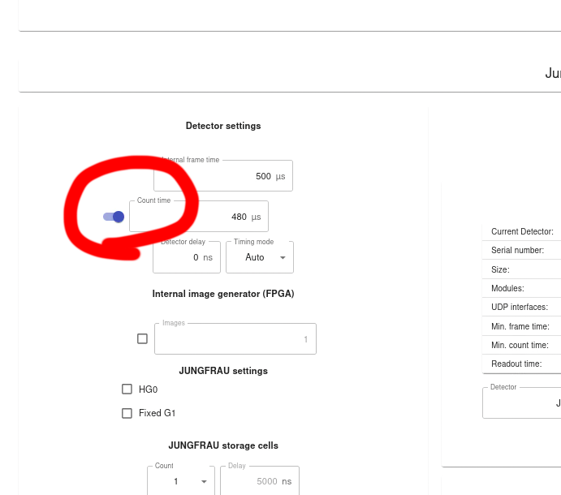

Troubleshooting
####################

Jungfraujoch
************

Negative values in image or halo around beam
=============================================

If the image has negative values or a halo around the beam, it could be that 
the wrong pedestal was recorded in G1/G2. Make sure Count time is set to 480us
and activated.

JFGui Installation
******************

Qt Platform Plugin Error
=========================

If you encounter an error like:

.. code-block:: console

   qt.qpa.plugin: Could not load the Qt platform plugin "xcb"
   This application failed to start because no Qt platform plugin could be initialized.

This means the Qt XCB platform plugin is missing system dependencies.

**Solution:**

Install the missing XCB cursor library:

.. code-block:: console

   $ sudo yum install xcb-util-cursor

For other distributions:

.. code-block:: console

   # Debian/Ubuntu
   $ sudo apt-get install libxcb-cursor0
   
   # Fedora
   $ sudo dnf install xcb-util-cursor

**Explanation:**

Qt requires the XCB (X C Binding) libraries to render GUI applications on Linux 
X11 display systems. The ``xcb-util-cursor`` package provides cursor rendering 
support required by the Qt platform plugin.

.. note::
   If you don't have sudo access, contact your system administrator to install 
   the ``xcb-util-cursor`` package.