Jungfrau GUI architecture
=========================

This page summarizes the high-level structure of the Jungfrau GUI, the external services it depends on,
and how the main UI components coordinate data acquisition, TEM control, and metadata tagging.

Architecture diagram
--------------------

   Click the diagram to open it in a new tab and zoom in.

Quick reading guide
-------------------

**Entry point**
  The application starts in ``main_ui.py``: connect to Redis, create the ZMQ receiver, create the main window,
  then enter the Qt event loop.

**Main window**
  ``ApplicationWindow`` (``ui_main_window.py``) is the composition root: it owns the pyqtgraph display objects and
  hosts the three main tabs.

**Tabs**
  - ``VisualizationPanel`` (``visualization_panel.py``): stream viewing + backend control (live/collect/pedestal/cancel)
  - ``TemControls`` (``tem_controls.py``): TEM control pipeline (actions + worker + tasks)
  - ``FileOperations`` (``file_operations.py``): experiment metadata/UI + snapshot orchestration + metadata tagging

**External services**
  - Noether hosts the Redis config DB, Jungfraujoch backend (ZeroMQ PUB/SUB), HDF5 storage, and the metadata updater server.
  - TEM PC hosts ``server_tem.py`` (pyJEM endpoint) controlling the microscope.

Notes on external libraries
---------------------------

- :ref:`ConfigurationClient <api-configurationclient>` and :ref:`JungfraujochWrapper <api-jungfraujochwrapper>` are provided by **epoc-utils** (external to this GUI repo).
- :ref:`TEMClient <api-temclient>` is provided by **simple_tem** (external to this GUI repo).

